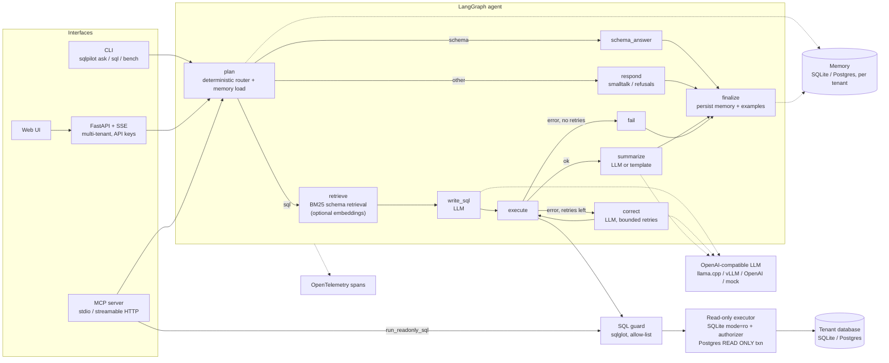

# sqlpilot

A text-to-SQL analyst agent you can put in front of real databases without handing an LLM write
access. Ask a question in plain English; sqlpilot picks the relevant tables, has an LLM write SQL,
checks that SQL with a parser-level guard, runs it read-only with row and time limits, repairs it
when it fails, and answers. It ships as a CLI, a multi-tenant HTTP API with a web UI and
Server-Sent Events, and an MCP server. It runs fully offline with a deterministic mock LLM, or
against any OpenAI-compatible endpoint (llama.cpp by default).

## The problem

"Chat with your database" demos usually do three risky or wasteful things:

1. **They trust the model's SQL.** A prompt-injected or confused model can emit `DROP TABLE`,
   `ATTACH DATABASE`, `COPY ... TO PROGRAM`, a data-modifying CTE, or read tables the user should
   never see.
2. **They paste the whole schema into every prompt.** On real schemas (hundreds of tables) that
   is slow and expensive, and small models get lost in it.
3. **They give up on the first error.** Small local models often write SQL that almost works: a
   wrong column name, a missing join. One round of "here is the error, fix it" recovers some of
   those.

sqlpilot addresses each one: a layered read-only security model, BM25 schema retrieval (with
bridge-table expansion and column pruning), and a bounded self-correction loop. It also measures
whether retrieval and self-correction actually help, on Spider dev with a 0.5B model (below).

## Quickstart (fresh clone, mock mode, no keys)

Mock mode uses a deterministic offline "LLM" that understands simple questions over the bundled
Chinook music-store database. It needs no model, no GPU and no API key; it is for trying the
plumbing, not for answer quality.

```bash
git clone https://github.com/fernandogarzaaa/sqlpilot && cd sqlpilot
python3 -m venv .venv && . .venv/bin/activate
pip install -e '.[dev]'          # runtime only: pip install -e '.[server,mcp]'
pytest -q                        # Postgres tests skip unless SQLPILOT_TEST_PG_URL is set
```

### 1. CLI

```bash
sqlpilot ask --llm mock "How many tracks are there?"
sqlpilot sql "SELECT Name FROM Artist ORDER BY Name LIMIT 3"
sqlpilot sql "DROP TABLE Artist"; echo "exit code: $?"   # rejected by the guard, exit code 1
```

`ask` prints each agent step on stderr, then the SQL, the rows and the answer. Conversation memory
goes to `.sqlpilot/memory.db` in the current directory (`--no-memory` to skip it).

### 2. HTTP API and web UI

```bash
sqlpilot serve --llm mock --demo-key demo-key-123 &
for i in $(seq 1 30); do curl -sf http://127.0.0.1:8000/healthz && break; sleep 1; done; echo
curl -s -X POST http://127.0.0.1:8000/v1/ask \
  -H 'X-API-Key: demo-key-123' -H 'Content-Type: application/json' \
  -d '{"question": "How many tracks are there?"}'; echo
curl -s -o /dev/null -w 'no key -> HTTP %{http_code}\n' http://127.0.0.1:8000/v1/tables
kill %1
```

While it runs, the web UI is at <http://127.0.0.1:8000/> (paste `demo-key-123` as the API key).
Endpoints: `GET /healthz`, `GET /v1/me`, `GET /v1/tables`, `GET /v1/tables/{name}`,
`POST /v1/sql`, `POST /v1/ask`, `POST /v1/ask/stream` (SSE, one event per agent step). Real
deployments use a tenants file instead of `--demo-key`: see `examples/tenants.toml` and
`sqlpilot hash-key`.

### 3. MCP server

`sqlpilot mcp` speaks MCP over stdio. Tools: `list_tables`, `describe_table`, `run_readonly_sql`,
`ask` (all annotated `readOnlyHint: true`), plus a `sqlpilot://capabilities` resource. A raw
JSON-RPC round trip from the shell:

```bash
{ echo '{"jsonrpc":"2.0","id":1,"method":"initialize","params":{"protocolVersion":"2025-06-18","capabilities":{},"clientInfo":{"name":"shell","version":"0"}}}'
  sleep 5
  echo '{"jsonrpc":"2.0","method":"notifications/initialized"}'
  echo '{"jsonrpc":"2.0","id":2,"method":"tools/call","params":{"name":"run_readonly_sql","arguments":{"sql":"SELECT COUNT(*) AS n FROM Artist"}}}'
  sleep 5
} | sqlpilot mcp --llm mock
```

(The sleeps keep stdin open long enough for the server to start and answer; a real MCP client
does this for you.) To use it from an MCP client such as Claude Desktop:

```json
{ "mcpServers": { "sqlpilot": { "command": "sqlpilot", "args": ["mcp", "--llm", "mock"] } } }
```

Point it at your own database with `--db path/to/file.sqlite` or `--db postgresql://...`, and at a
real model with `--llm openai --llm-base-url http://127.0.0.1:8080/v1`.

### 4. docker compose (Postgres + API)

```bash
docker compose up --build
# API + web UI on http://localhost:8000
#   key demo-pg-key-123     -> Chinook on Postgres (read-only role)
#   key demo-sqlite-key-123 -> bundled Chinook SQLite, catalog tables only
```

This starts Postgres 16 (seeded with Chinook, plus a `SELECT`-only role) and the API with the mock
LLM. Set `SQLPILOT_LLM=openai` and `SQLPILOT_LLM_BASE_URL` to use a real model. **Not run
locally:** see [What is untested](#limitations-and-what-is-untested).

### Using a real model

Any OpenAI-compatible `/v1/chat/completions` endpoint works. With llama.cpp:

```bash
llama-server -m qwen2.5-0.5b-instruct-q4_k_m.gguf --port 8080 -c 4096
sqlpilot ask --llm openai --llm-base-url http://127.0.0.1:8080/v1 "Which genre has the most tracks?"
```

Settings are also read from `SQLPILOT_*` environment variables (`SQLPILOT_LLM`,
`SQLPILOT_LLM_BASE_URL`, `SQLPILOT_LLM_MODEL`, `SQLPILOT_LLM_API_KEY`, `SQLPILOT_MAX_RETRIES`,
`SQLPILOT_TOP_K_TABLES`, `SQLPILOT_LLM_SUMMARY`, `SQLPILOT_MEMORY_URL`, ...; see
`src/sqlpilot/config.py`).

## Results: execution accuracy on Spider dev

Model: Qwen2.5-0.5B-Instruct, Q4_K_M GGUF, on llama.cpp, CPU only. Sample: 150 Spider dev
questions drawn with seed 42 (`sqlpilot bench --n 150 --seed 42`). Raw per-question results and
the generated summary are in [`bench/results/qwen2.5-0.5b/`](bench/results/qwen2.5-0.5b/).

| Config | Questions run | EX | Failed to execute | Prompt tok / q | LLM calls / q | Mean latency |
|---|---|---|---|---|---|---|
| zero-shot (full schema) | 150 / 150 | **26.7%** (40) | 44.0% | 299 | 0.99 | 3.8 s |
| schema retrieval | 150 / 150 | **39.3%** (59) | 32.0% | 266 | 0.99 | 9.2 s |
| retrieval + self-correction | **126 / 150 (incomplete)** | 40.5% (51 of 126) | 27.0% | 470 | 1.56 | 15.1 s |

Honest notes:

- **The self-correction run is incomplete.** It stopped after 126 of the 150 questions, so its
  row is not directly comparable with the other two. On the *same* 126 questions the three
  configs score 27.0% (zero-shot), 40.5% (retrieval) and 40.5% (retrieval + self-correction):
  self-correction cut execution failures from 30.2% to 27.0% but did not change EX (it fixed 2
  questions and broke 2 others), at about 1.6x the LLM calls and 1.8x the prompt tokens.
- **Schema retrieval is the clear win** with this model: +12.7 points EX over zero-shot on all 150
  questions, and fewer prompt tokens.
- "Failed to execute" counts every question that ended without a result: SQL errors plus guard
  rejections (3, 5 and 3 rejections respectively).
- "LLM calls / q" is below 1.00 because the deterministic router sent one question (#651, "List
  the final tables made and the best finishes of all poker players") to the schema-description
  branch because "List ... tables" matches its schema-question pattern, so no SQL was written. That is a known
  router false positive; it is counted as wrong in every config.
- **Latency is not comparable across configs.** The CPU was shared with other jobs and the
  contention changed during the runs.
- Retrieval settings (top-k, thresholds) were tuned on the other 884 Spider dev questions, not on
  this sample. The tuning runs themselves are not in this repository.
- EX here is a close re-implementation of Spider's execution match (multiset or ordered rows,
  floats rounded to 4 places, column permutations accepted), not the official evaluation script,
  and 150 questions is a small sample (a 95% interval on 40% is roughly +/- 8 points).
- These runs used the code before the last retrieval refactor in this commit. That refactor only
  changed empty-schema handling and clamps the embeddings-mixed score, neither of which the BM25
  path used here exercises.
- Only this one model was benchmarked. No other model results are reported.

Reproduce (needs the Spider data, ~200 MB, and a running endpoint):

```bash
make bench-data                     # downloads Spider into .bench_data/
sqlpilot bench --n 150 --seed 42 --llm openai --llm-base-url http://127.0.0.1:8080/v1 \
  --out bench/results/my-model
```

The run is resumable: finished question ids are skipped if you restart it.

## Test quality: mutation testing

The security- and logic-critical modules (`guard.py`, `retrieval.py`, `routing.py`, `auth.py`)
are graded with [testteeth](https://pypi.org/project/testteeth/) 0.2.0 mutation testing (`make
mutation`): it changes the code (flips comparisons, changes constants, removes calls) and checks
that some test fails.

MUTATION_TABLE

Full reports: [`docs/mutation/baseline.txt`](docs/mutation/baseline.txt) and
[`docs/mutation/after.txt`](docs/mutation/after.txt) (JSON next to each).

## Architecture



Source map: `agent.py` (graph), `routing.py` (pure routing), `retrieval.py` (BM25, bridge
tables, column pruning, hybrid scoring), `guard.py` (SQL guard), `db.py` (executors), `llm.py`
(OpenAI-compatible client, mock, embeddings client), `memory.py`, `auth.py` (tenants and keys),
`api.py`, `mcp_server.py`, `tracing.py`, `bench.py`, `cli.py`.

## Security model

The goal: **no input (question, prompt injection in data, or raw SQL sent to `/v1/sql` or
`run_readonly_sql`) can modify data, read outside the tenant's database or table allow-list, or
exhaust the server.** Defences are layered so one bug does not open everything:

1. **SQL guard** (`guard.py`, sqlglot): exactly one statement; only `SELECT`, `WITH ... SELECT` and
   set operations. Rejected anywhere in the parse tree: writes and DDL (including data-modifying
   CTEs and `SELECT ... INTO`), engine commands (`PRAGMA`, `ATTACH`, `COPY`, `SET`, transactions),
   row locks, dangerous functions (`load_extension`, `pg_*`, `dblink`, `query_to_xml`,
   `nextval`, ...), and tables outside the tenant's allow-list. SQL the parser cannot parse is
   rejected, not passed through.
2. **Read-only execution** (`db.py`): SQLite is opened `mode=ro` with `query_only` and an
   authorizer that only allows reads; Postgres queries run in a `READ ONLY` transaction with
   `statement_timeout` and are always rolled back.
3. **Limits**: per-tenant row caps and time limits, and size limits on questions and SQL.
4. **Least privilege (your part)**: give each tenant a database role with `SELECT` grants only
   (`docker/initdb/02-readonly-role.sh` shows how), never a superuser.
5. **Authentication and isolation**: API keys are stored only as SHA-256 hashes and compared in
   constant time; each key maps to one tenant; conversation memory and stored examples are
   scoped per tenant.

Known gaps: query cost is bounded by time, not estimated; there is no built-in rate limiting
(put the API behind a gateway); query results go to the configured LLM for summarisation (use a
local model or `SQLPILOT_LLM_SUMMARY=false` for sensitive data); the web UI keeps the API key in
`localStorage`. See [SECURITY.md](SECURITY.md) for reporting vulnerabilities.

## Limitations and what is untested

What was run locally: the full test suite on Python 3.12 (Postgres tests skipped), ruff, mypy
`--strict`, mutation testing, the Spider benchmark above, and the CLI, `serve` and MCP stdio
quickstart commands from a fresh clone. Everything below was **not** verified locally:

- **Postgres paths** (Postgres executor, Postgres memory store, `tests/test_postgres.py`): run in
  CI only (the CI workflow starts a Postgres 16 service). Locally those 4 tests are skipped.
- **Python 3.10 and 3.11**: declared supported and in the CI matrix, but not run locally.
- **mcp 1.x**: the server has a compatibility path for mcp 1.x, but only mcp 2.x (2.3.0) was
  installed and tested.
- **Docker image and docker compose**: neither the build nor `docker compose up` was run.
- **The web UI** was not checked visually in a browser; only the API behind it is tested.
- **The embeddings path** (hybrid BM25 + cosine retrieval via `OpenAIEmbedder`) is unit-tested
  with fake embedders only and was never run against a real embeddings endpoint. It is reachable
  from the Python API (`SQLAgent(..., embedder=...)`), not from the CLI or server settings.
- **Other models**: only Qwen2.5-0.5B-Instruct was benchmarked. A Qwen2.5-Coder-1.5B run was
  attempted and discarded because the model server died mid-run; there are no results for it.
- **Benchmark scope**: one small model, 150 questions, a re-implemented EX metric, and an
  incomplete self-correction run (126/150), as described above.
- The mock LLM handles only simple question shapes; it exists for offline demos and tests.
- The router is regex-based: a data question shaped like "list/show/which ... tables" (within 20
  characters) is answered with a schema description instead of SQL (see the benchmark notes).

## Development

```bash
make lint typecheck test   # ruff, mypy --strict, pytest
make mutation              # testteeth on guard/retrieval/routing/auth
make test-pg               # Postgres tests in a throwaway container (needs Docker)
```

See [CONTRIBUTING.md](CONTRIBUTING.md) and [CHANGELOG.md](CHANGELOG.md).

## License

MIT. See [LICENSE](LICENSE).
